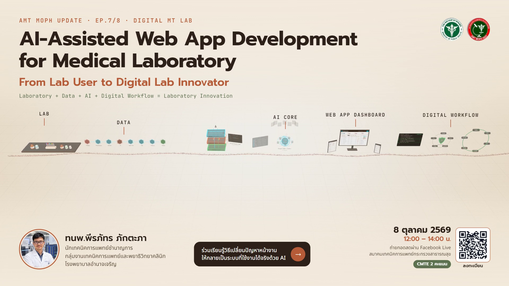

# Lab to App — WebGL Promo

**AI-Assisted Web App Development for Medical Laboratory**
From Lab User to Digital Lab Innovator

AMT MOPH Update · EP.7/8 · Digital MT Lab
8 ตุลาคม 2569 · 12:00–14:00 น. · ถ่ายทอดสดผ่าน Facebook Live สมาคมเทคนิคการแพทย์กระทรวงสาธารณสุข · CMTE 2 คะแนน

## ▶ ดูเวอร์ชัน Interactive

**https://peerapat-mt.github.io/lab-to-app-webgl/**

- คลิกหนึ่งครั้งเพื่อเปิดเสียง
- ลากเมาส์ = หมุนมุมมอง · Scroll = เลื่อน Timeline · Space = เล่น/หยุด
- ฉาก Web App: คลิกหน้าจอ Dashboard เพื่อเปิดตัวอย่างที่ค้นหาและกรองได้จริง

แนะนำให้เปิดบนคอมพิวเตอร์ด้วย Chrome หรือ Edge

## 🎬 วิดีโอ (1080p · 50 วินาที · มีเสียง)

- ดูออนไลน์: **https://peerapat-mt.github.io/lab-to-app-webgl/Lab_to_App_1080p.mp4**
- ดาวน์โหลด: [Lab_to_App_1080p.mp4](Lab_to_App_1080p.mp4) → กด Download raw file

## เรื่องราว (50 วินาที)

LAB → DATA → AI → WEB APP → INNOVATION

1. ปัญหาในห้อง Lab — คุณไม่จำเป็นต้องเป็น Programmer ก่อน
2. Problem → Requirement → Prompt → AI → Web App → Test → Improve → Deploy
3. Digital Lab Stack: Google Sheets · Google Apps Script · Visual Studio Code · Claude Code / Codex · Web App
4. AI Coding Agent อ่าน Project → วางแผน → แก้ Files → Review → Test
5. Prompting ด้วย R-C-T-F-C — Prompt สั้นได้ แต่ Context ต้องพอ
6. Lab Reagent Inventory Web App (Desktop · Tablet · Smartphone)
7. Human-in-the-loop — AI Generated ≠ Correct
8. Build → Test → Improve → Deploy
9. From Lab User to Digital Lab Innovator

ข้อมูลใน Dashboard เป็นข้อมูลสมมติทั้งหมด ไม่มีข้อมูลผู้ป่วย

---
ทนพ.พีรภัทร ภักตะภา · นักเทคนิคการแพทย์ชำนาญการ · กลุ่มงานเทคนิคการแพทย์และพยาธิวิทยาคลินิก โรงพยาบาลอำนาจเจริญ
